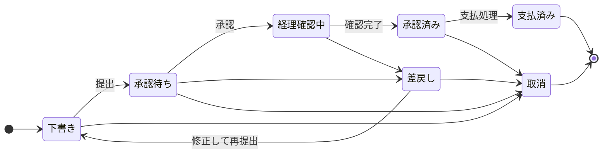

# 経費精算アプリケーション 仕様書(ドラフト)

作成日: 2026-10-20

## 1. 概要と目的

社内の経費申請を ServiceNow 上で一元管理し、申請から承認、経理確認、支払までを一つの流れで完結させる。

- 目的: 紙・メール・表計算による申請の廃止、承認リードタイムの短縮、規程違反の自動検知
- 対象ユーザー: 全従業員(申請者)、上長・部門長(承認者)、経理担当、アプリ管理者
- 期待効果: 申請から支払までの所要日数の可視化、領収書の紛失防止、監査対応の工数削減
- 開発方式: ServiceNow Fluent SDK(`@servicenow/sdk`)でコードとして管理し、ビルドとデプロイを自動化する

## 2. スコープと前提

本書は要件ヒアリング前のドラフトであり、次の仮定を置いている。確定が必要な点は13章に集約した。

**初期リリースの対象**

- 経費申請(交通費、出張費、交際費、備品購入、その他)と明細の入力
- 領収書の添付
- 多段承認(上長、部門長)と差戻し
- 経理確認と支払ステータスの管理
- 一覧・フォーム・ダッシュボードを備えた Workspace 画面

**初期リリースの対象外**

- 会計システムへの連携、仕訳の自動生成
- IC カード・クレジットカード明細の取込
- 領収書の OCR 読取
- 外貨の自動換算(通貨は JPY のみとする)
- モバイル専用アプリ

**前提**

- ユーザーとグループは標準の `sys_user` と `sys_user_group` を利用する
- 承認は最大3段(上長、部門長、経理)で、部門長は金額が閾値を超えたときだけ入る
- 開発と検証は PDI で行い、確定後に本番へ展開する

## 3. ロールと権限

4つのロールを定義し、申請者は自分の申請だけ、承認者は部下の申請だけ、経理と管理者は全件を扱えるようにする。ロール名のプレフィックスは、アプリ作成時に決まるスコープ名(`x_<接頭辞>_expense`)に合わせる。

| ロール | 対象 | できること |
| --- | --- | --- |
| `expense.user` | 全従業員(申請者) | 自分の経費申請を作成、下書き・差戻し中の申請を編集、取消。他人の申請は見えない |
| `expense.approver` | 上長・部門長 | 自分が承認者になっている申請の閲覧、承認、差戻し(理由必須) |
| `expense.accounting` | 経理担当 | 全申請の閲覧、経理確認、差戻し、支払済みへの更新、集計・エクスポート |
| `expense.admin` | アプリ管理者 | カテゴリ・閾値・通知設定の管理、全データの閲覧と修正 |

経理担当と管理者は申請者としても使えるが、自分が申請した経費は自分で承認・経理確認できない(自己承認の禁止)。

## 4. 業務フロー



状態の補足: 承認待ちは上長、金額が閾値以上なら部門長の順に進む。差戻しは理由の入力が必須。

申請は提出、承認、経理確認、支払の順に進む。承認者と経理は差戻しでき、申請者は修正して再提出する。取消は支払前のみで、取り消した申請は再開できない。

## 5. データモデル

カスタムテーブルを3つ作り、領収書は標準の添付(`sys_attachment`)を使う。テーブル名のプレフィックスはスコープ名に従う。

**経費申請 `expense_report`** (1件の申請)

| 項目 | 型 | 備考 |
| --- | --- | --- |
| number | 自動採番 | `EXP0000001` 形式 |
| title | 文字列(120) | 必須 |
| requester | 参照(`sys_user`) | 既定はログインユーザー、変更不可 |
| department | 参照(`cmn_department`) | 申請者から自動設定 |
| purpose | 文章 | 申請の目的・背景 |
| state | 選択 | 下書き / 承認待ち / 経理確認中 / 差戻し / 承認済み / 支払済み / 取消 |
| total_amount | 通貨(JPY) | 明細の合計、自動計算、読取専用 |
| current_approver | 参照(`sys_user`) | いま承認を待っている人 |
| submitted_on / paid_on | 日付 | 申請日と支払日 |
| reject_reason | 文章 | 差戻し時に必須 |

**明細 `expense_item`** (申請にぶら下がる費目ごとの行)

| 項目 | 型 | 備考 |
| --- | --- | --- |
| report | 参照(`expense_report`) | 必須、申請削除時はカスケード削除 |
| expense_date | 日付 | 必須、未来日は不可 |
| category | 参照(`expense_category`) | 必須 |
| amount | 通貨(JPY) | 必須、1円以上 |
| payee / description | 文字列 | 支払先と内容 |
| policy_flag | 真偽値 | 規程違反の疑いがあると自動で true |

**カテゴリ `expense_category`** (管理者が管理するマスター)

| 項目 | 型 | 備考 |
| --- | --- | --- |
| name / code | 文字列 | `code` は一意 |
| receipt_threshold | 通貨(JPY) | この金額以上の明細は領収書が必須 |
| daily_limit | 通貨(JPY) | 1日1人あたりの上限(任意) |
| active | 真偽値 | 既定は true |

## 6. 機能要件

申請から支払までの10機能を初期リリースに含める。金額の閾値は仮置きで、管理者がシステムプロパティで変更できる。

| ID | 機能 | 内容とビジネスルール |
| --- | --- | --- |
| FR-01 | 申請の作成 | 下書きで保存できる。申請者と部門は自動設定する |
| FR-02 | 明細の入力 | 日付・カテゴリ・金額を必須とする。未来の日付と 0 円以下は拒否する。合計金額は自動計算する |
| FR-03 | 領収書の添付 | カテゴリの `receipt_threshold` 以上の明細は、添付がないと提出できない |
| FR-04 | 申請の提出 | 明細が1件以上必要。提出後は申請者が編集できない。承認者を自動で決める |
| FR-05 | 承認 | 上長、金額が閾値(仮: 100,000 円)以上なら部門長の順。自己承認は禁止する |
| FR-06 | 差戻し | 承認者と経理ができる。理由の入力を必須とする。申請者が直して再提出できる |
| FR-07 | 経理確認 | 領収書と金額を確認して承認済みにする。規程違反フラグの付いた明細を強調表示する |
| FR-08 | 支払処理 | 経理が支払日を入力して支払済みにする。支払済みの申請は変更できない |
| FR-09 | 申請の取消 | 申請者は支払前なら取り消せる。取消後は再開できない |
| FR-10 | 集計と確認 | 部門別・カテゴリ別・月別の金額、承認待ち件数、申請から支払までの日数を表示する |

**規程違反の自動検知**(`policy_flag` を立てる条件)

- 同じ申請者・同じ日付・同じ金額・同じ支払先の明細がすでにある(重複の疑い)
- カテゴリの `daily_limit` を超えている
- 明細の日付が提出日から 60 日以上前(仮)

## 7. 画面構成

Next Experience の Workspace(URL は `/now/expense/home`)を中心にし、よく使う操作はフォーム上のボタンにする。

| 画面 | 主な利用者 | 内容 |
| --- | --- | --- |
| ホーム(ダッシュボード) | 全員 | 自分の申請状況、承認待ち件数。経理は部門別・カテゴリ別・月別の金額と、申請から支払までの日数 |
| 一覧 | 全員 | 「自分の申請」「承認待ち」「経理確認待ち」「全件」のビュー。ロールで見えるビューが変わる |
| 申請フォーム | 全員 | 基本項目、明細の関連リスト、領収書の添付、承認の履歴。状態に応じたボタン(提出、承認、差戻し、支払済みにする、取消)を表示する |
| カテゴリ管理 | 管理者 | カテゴリと領収書の閾値の管理 |

フォームの挙動は UI Policy と Client Script で制御する。

- 提出後は全項目を読取専用にする
- 差戻し時は `reject_reason` を必須にする
- 明細で選んだカテゴリの領収書必須の閾値を、入力中に案内する

### UI Page(React)の利用方針

初期リリースは標準の Workspace で作り、操作性の改善が必要な画面だけ、React の UI Page で追加する。UI Page は Fluent の `UiPage` で定義でき、React 18.2.0 と ServiceNow 公式の `@servicenow/react-components` を使う。

| 候補の画面 | 内容 | 使う部品 |
| --- | --- | --- |
| 明細の入力画面 | 申請の中で、明細をその場で追加・編集する | `RecordProvider`、`FormColumnLayout` |
| 承認画面 | 承認待ちの一覧から、1件ずつ確認して承認・差戻しする | `NowRecordListConnected`、`Button`、`Modal` |

- UI Page は独立したページとして動く。URL は、スコープ名で始まる名前(`x_<接頭辞>_expense_` で始まる)にする。Workspace からは、メニューやリンクでつなぐ
- 画面の切替は、`?view=list` のような URL パラメーターで行う
- 一覧と記録の編集は、専用の部品を使う。ACL と項目単位の読み取り専用の設定が、そのまま反映される
- 実装量が増えるため、第2フェーズ以降に判断する

## 8. 通知と自動化

状態が変わるたびに、次に動く人へメールを送る。承認待ちが3営業日以上続いたときだけ、定期ジョブでリマインドを送る。

| イベント | 宛先 | 内容 |
| --- | --- | --- |
| 提出 | 現在の承認者 | 承認依頼と申請へのリンク |
| 承認段階の進行 | 次の承認者 | 承認依頼 |
| 差戻し | 申請者 | 差戻し理由と修正を促す案内 |
| 経理確認への回付 | 経理担当グループ | 確認依頼 |
| 支払済み | 申請者 | 支払日と金額 |
| 承認待ちが3営業日超 | 現在の承認者 | リマインド(毎日朝の定期ジョブ) |

承認者が不在の場合の代理承認は、ServiceNow 標準のデリゲーション機能を使う。

## 9. セキュリティとコンプライアンス

テーブルごとに ACL を定義し、ロールに加えて「自分の申請」「承認者として指名された申請」という行の条件を使う。

| テーブル | 読取 | 作成 | 書込 | 削除 |
| --- | --- | --- | --- | --- |
| `expense_report` | 申請者本人、現在・過去の承認者、経理、管理者 | `expense.user` | 下書き・差戻し中は申請者、それ以外は承認者・経理が状態とコメントのみ | 管理者のみ |
| `expense_item` | 親の申請を読める人 | 下書き・差戻し中の申請者 | 下書き・差戻し中の申請者 | 下書き・差戻し中の申請者 |
| `expense_category` | 全員 | 管理者 | 管理者 | 管理者 |

- 監査: 申請の `state`、`total_amount`、`current_approver` と明細の `amount` の変更履歴を標準の監査機能で記録する
- 承認の証跡: 承認者、日時、コメントをジャーナルに残す
- データ保持: 支払済みの申請と領収書は、経理規程の保存期間に従う(仮: 7 年)
- 領収書には個人情報が含まれるため、添付も申請と同じ読取制限を適用する

## 10. 非機能要件

- 性能: 一覧の初回表示を 3 秒以内、明細は1申請あたり 50 件までを想定する(仮)
- 可用性: ServiceNow プラットフォームの可用性に従う
- 言語と通貨: 日本語、JPY のみ
- 保守性: すべての設定を Fluent のコードとして Git で管理する。インスタンス上での直接編集は行わない
- デプロイ: `now-sdk build --frozenKeys` の後に `now-sdk install` を実行する。認証は OAuth の `client_credentials`(`SN_SDK_OAUTH_CLIENT_ID` と `SN_SDK_OAUTH_CLIENT_SECRET`)を使う
- テスト: ATF で主要シナリオ(提出、承認、差戻し、支払、自己承認の拒否)と ACL を検証し、リリース前に利用部門で受入テストを行う

## 11. Fluent 実装構成

要件を Fluent のメタデータ種別に対応づける。API 名は SDK 4.13.6 のドキュメント(`now-sdk explain`)で確認済み。

| 要件 | Fluent API |
| --- | --- |
| 3つのテーブル | `Table` |
| ロールと権限 | `Role`、`Acl`、`Applicability` |
| 合計金額の計算、必須チェック、重複検知 | `BusinessRule`、`ScriptInclude` |
| フォームの挙動 | `UiPolicy`、`ClientScript`、`Form` |
| ボタン(提出、承認、差戻しなど) | `UiAction` |
| 承認フローとリマインド | `Flow`(Workflow Automation)、定期実行はスケジュールトリガー |
| メール通知 | `EmailNotification` |
| 閾値の設定 | `Property` |
| 画面 | `Workspace`、`UxListMenuConfig`、`Dashboard` |

```
src/
  fluent/
    tables/            expense-report.now.ts, expense-item.now.ts, expense-category.now.ts
    security/          roles.now.ts, acls.now.ts
    business-rules/    合計計算、提出時チェック、規程違反フラグ
    ui/                ui-actions, ui-policies, client-scripts
    flows/             承認フロー、リマインド
    notifications/     メール通知
    workspace/         workspace, list-menu, dashboard
  server/              ビジネスロジックの TypeScript
```

既存の Hello Fluent とは別のプロジェクト(別の `now.config.json` とスコープ)として作る。

UI Page を追加する場合は、`src/client/`(React のソース)と `src/fluent/ui-pages/`(`UiPage` の定義)を加える。ビルド設定ファイルは作らず、SDK のビルドに任せる。

## 12. 開発フェーズ

4つのフェーズで段階的に作り、各フェーズを PDI へデプロイして確認してから次へ進む。期間は要件確定後に見積もる。

1. **基盤**: 3つのテーブル、ロール、ACL、カテゴリの初期データ。完了条件: 申請者が自分の申請だけを作成・閲覧できる
2. **申請から承認まで**: 明細と領収書、提出チェック、承認・差戻しのボタン、承認フロー。完了条件: 提出から承認済みまでを ATF で通せる
3. **経理確認と通知**: 経理確認、支払処理、規程違反の検知、メール通知、リマインド。完了条件: 経理担当が支払済みまで操作でき、自己承認が拒否される
4. **Workspace と受入**: Workspace、一覧ビュー、ダッシュボード。必要に応じて、React の UI Page(7章)を追加する。利用部門で受入テストを行い、本番へ展開する。完了条件: 受入テストの指摘が解消されている

## 13. 未確定事項

以下が決まると、仮置きの値を確定できる。

- [ ] 承認ルート: 上長をどこから決めるか(ユーザーの `manager` 項目でよいか)、部門長の承認閾値(仮: 100,000 円)
- [ ] 経理確認: 担当グループをどう分けるか、経理側でも多段承認が必要か
- [ ] 経費カテゴリ: 一覧と、カテゴリごとの領収書必須金額・日次上限
- [ ] 規程: 保存期間(仮: 7 年)、申請期限(仮: 支出から 60 日)
- [ ] 支払方法: 給与振込との連携有無、会計システム連携をいつ行うか
- [ ] 利用人数、対象部門、対象インスタンス(本番の環境)
- [ ] モバイル利用や OCR の要否と時期

- [ ] UI Page(React)で作る画面の範囲(明細の入力画面、承認画面)と時期
